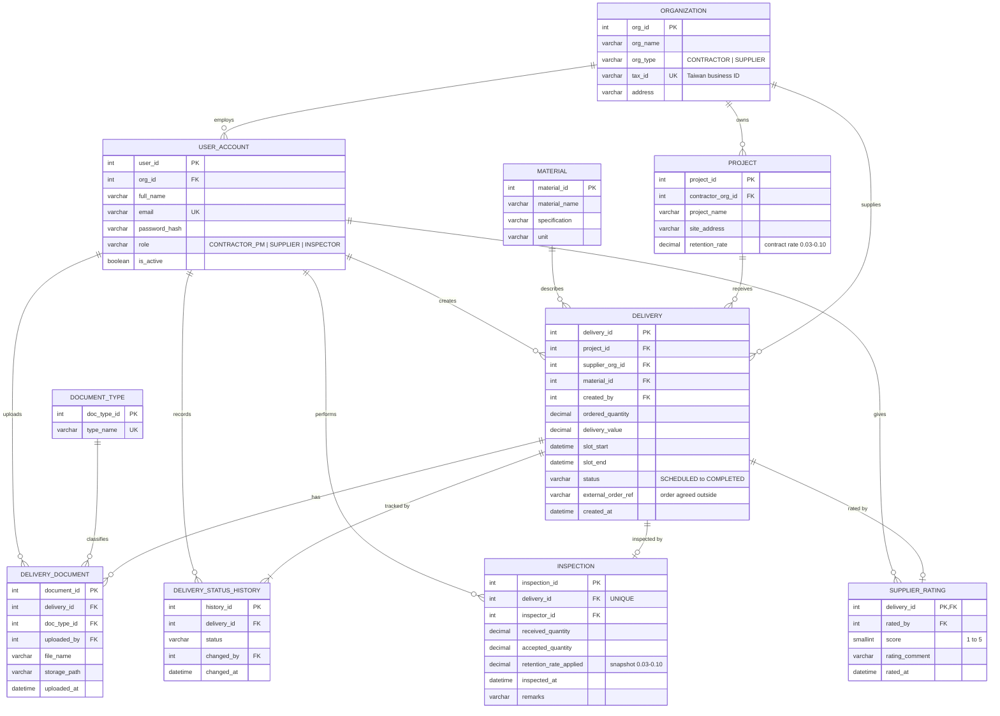

# SiteProof — Normalized Data Model (ER Diagram, 3NF)

Data model for the **SiteProof** platform, built from the user stories (US1–US9) and use cases (UC1–UC10) of the [Business Plan v3](Assignment%20%231/Business_Plan_v3.pdf).
Modeling steps follow the course lecture on relational data modeling (identify entities and attributes, naming conventions, relationships and cardinality, keys, normalization).

## 1. Scope legend: MVP vs. full product

| Tag | Color in Figure 2 | Meaning |
|---|---|---|
| **MVP** | 🟩 green, thick border | Entities and attributes the team will actually build in Phase 1. The “five must-have functions” mean the five workflow stages; UC1–UC10 are their MVP use cases and shared sign-in prerequisite. |
| **PHASE 2** | 🟨 yellow | Planned expansion: RFQ, LINE notifications, payment requests, Pro tier, featured suppliers, ESG tracking. |
| **PHASE 3** | ⬜ grey, dashed border | Future intelligence: OCR, budget alerts, GPS, ERP integration, delivery-risk analytics. |

* In Figure 2, entities are tagged in the diagram header (`ENTITY - MVP`, `- PHASE 2`, `- PHASE 3`) and colored.
* **Attributes** that belong to a later phase but live inside an MVP table are marked in the attribute comment (for example `quotation_id FK "Phase 2: RFQ"`). They are *not* part of the MVP schema; Figure 1 shows the MVP schema without them.
* If a viewer does not render colors, the tags and attribute comments still carry the distinction.

## 2. Figure 1 — MVP data model (what we implement first)

10 entities, covering all nine user stories and all ten use cases.

> 📝 **UPDATED — scope clarification:** The five must-have functions are the five workflow stages listed in README section 1. UC1–UC10 are all in MVP as detailed use cases; UC1 is a shared prerequisite.



## 3. Figure 2 — Full product data model (MVP + Phase 2 + Phase 3)

24 entities. The 10 MVP entities are the same as in Figure 1, plus the later-phase attributes inside them.

```mermaid
erDiagram
    ORGANIZATION["ORGANIZATION - MVP"] {
        int org_id PK
        varchar org_name
        varchar org_type "CONTRACTOR | SUPPLIER"
        varchar tax_id UK "Taiwan business ID"
        varchar address
        int parent_org_id FK "Phase 2: branch / office"
    }
    USER_ACCOUNT["USER_ACCOUNT - MVP"] {
        int user_id PK
        int org_id FK
        varchar full_name
        varchar email UK
        varchar password_hash
        varchar role "CONTRACTOR_PM | SUPPLIER | INSPECTOR"
        boolean is_active
        varchar line_user_id "Phase 2: LINE"
    }
    PROJECT["PROJECT - MVP"] {
        int project_id PK
        int contractor_org_id FK
        varchar project_name
        varchar site_address
        decimal retention_rate "contract rate 0.03-0.10"
    }
    MATERIAL["MATERIAL - MVP"] {
        int material_id PK
        varchar material_name
        varchar specification
        varchar unit
        int category_id FK "Phase 2"
    }
    DOCUMENT_TYPE["DOCUMENT_TYPE - MVP"] {
        int doc_type_id PK
        varchar type_name UK
    }
    DELIVERY["DELIVERY - MVP"] {
        int delivery_id PK
        int project_id FK
        int supplier_org_id FK
        int material_id FK
        int created_by FK
        decimal ordered_quantity
        decimal delivery_value
        datetime slot_start
        datetime slot_end
        varchar status "SCHEDULED to COMPLETED"
        varchar external_order_ref "order agreed outside"
        datetime created_at
        int quotation_id FK "Phase 2: RFQ, nullable"
        int payment_request_id FK "Phase 2: payment, nullable"
    }
    DELIVERY_STATUS_HISTORY["DELIVERY_STATUS_HISTORY - MVP"] {
        int history_id PK
        int delivery_id FK
        varchar status
        int changed_by FK
        datetime changed_at
    }
    DELIVERY_DOCUMENT["DELIVERY_DOCUMENT - MVP"] {
        int document_id PK
        int delivery_id FK
        int doc_type_id FK
        int uploaded_by FK
        varchar file_name
        varchar storage_path
        datetime uploaded_at
    }
    INSPECTION["INSPECTION - MVP"] {
        int inspection_id PK
        int delivery_id FK "UNIQUE"
        int inspector_id FK
        decimal received_quantity
        decimal accepted_quantity
        decimal retention_rate_applied "snapshot 0.03-0.10"
        datetime inspected_at
        varchar remarks
    }
    SUPPLIER_RATING["SUPPLIER_RATING - MVP"] {
        int delivery_id PK,FK
        int rated_by FK
        smallint score "1 to 5"
        varchar rating_comment
        datetime rated_at
    }
    SUPPLIER_CONNECTION["SUPPLIER_CONNECTION - PHASE 2"] {
        int contractor_org_id PK,FK
        int supplier_org_id PK,FK
        varchar connection_status
        datetime connected_at
    }
    MATERIAL_CATEGORY["MATERIAL_CATEGORY - PHASE 2"] {
        int category_id PK
        varchar category_name UK
    }
    RFQ["RFQ - PHASE 2"] {
        int rfq_id PK
        int project_id FK
        int material_id FK
        int created_by FK
        decimal quantity
        date needed_by
        varchar rfq_status
    }
    QUOTATION["QUOTATION - PHASE 2"] {
        int quotation_id PK
        int rfq_id FK
        int supplier_org_id FK
        decimal unit_price
        int lead_time_days
        varchar quotation_status
        datetime submitted_at
    }
    NOTIFICATION["NOTIFICATION - PHASE 2"] {
        int notification_id PK
        int user_id FK
        int delivery_id FK "nullable"
        int budget_id FK "Phase 3, nullable"
        varchar channel "LINE"
        varchar notification_type
        datetime scheduled_for
        datetime sent_at
    }
    PAYMENT_REQUEST["PAYMENT_REQUEST - PHASE 2"] {
        int payment_request_id PK
        int supplier_org_id FK
        int project_id FK
        date valuation_period
        varchar request_status
        datetime submitted_at
    }
    SUBSCRIPTION["SUBSCRIPTION - PHASE 2"] {
        int subscription_id PK
        int org_id FK
        varchar tier "FREE | PRO"
        varchar billing_cycle
        date start_date
        date end_date
    }
    FEATURED_LISTING["FEATURED_LISTING - PHASE 2"] {
        int listing_id PK
        int supplier_org_id FK
        int category_id FK
        date start_date
        date end_date
    }
    ESG_RECORD["ESG_RECORD - PHASE 2"] {
        int esg_id PK
        int delivery_id FK "UNIQUE"
        varchar certification_label
        decimal carbon_kg_co2e
    }
    DOCUMENT_EXTRACTION["DOCUMENT_EXTRACTION - PHASE 3"] {
        int extraction_id PK
        int document_id FK
        varchar field_name
        varchar extracted_value
        decimal confidence
        datetime extracted_at
    }
    PROJECT_BUDGET["PROJECT_BUDGET - PHASE 3"] {
        int budget_id PK
        int project_id FK
        int category_id FK
        decimal budget_amount
        decimal alert_threshold_pct
    }
    DELIVERY_TRACKING_POINT["DELIVERY_TRACKING_POINT - PHASE 3"] {
        int point_id PK
        int delivery_id FK
        decimal latitude
        decimal longitude
        datetime recorded_at
    }
    ERP_SYNC_LOG["ERP_SYNC_LOG - PHASE 3"] {
        int sync_id PK
        int org_id FK
        int delivery_id FK "nullable"
        varchar direction
        varchar sync_status
        datetime synced_at
    }
    DELIVERY_RISK_SCORE["DELIVERY_RISK_SCORE - PHASE 3"] {
        int score_id PK
        int delivery_id FK
        varchar model_version
        decimal risk_score
        datetime computed_at
    }

    ORGANIZATION ||--o{ USER_ACCOUNT : employs
    ORGANIZATION ||--o{ PROJECT : owns
    ORGANIZATION ||--o{ DELIVERY : supplies
    PROJECT ||--o{ DELIVERY : receives
    MATERIAL ||--o{ DELIVERY : describes
    USER_ACCOUNT ||--o{ DELIVERY : creates
    DELIVERY ||--|{ DELIVERY_STATUS_HISTORY : "tracked by"
    USER_ACCOUNT ||--o{ DELIVERY_STATUS_HISTORY : records
    DELIVERY ||--o{ DELIVERY_DOCUMENT : has
    DOCUMENT_TYPE ||--o{ DELIVERY_DOCUMENT : classifies
    USER_ACCOUNT ||--o{ DELIVERY_DOCUMENT : uploads
    DELIVERY ||--o| INSPECTION : "inspected by"
    USER_ACCOUNT ||--o{ INSPECTION : performs
    DELIVERY ||--o| SUPPLIER_RATING : "rated by"
    USER_ACCOUNT ||--o{ SUPPLIER_RATING : gives

    ORGANIZATION ||--o{ ORGANIZATION : "has branch"
    ORGANIZATION ||--o{ SUPPLIER_CONNECTION : "lists as contractor"
    ORGANIZATION ||--o{ SUPPLIER_CONNECTION : "listed as supplier"
    MATERIAL_CATEGORY ||--o{ MATERIAL : groups
    PROJECT ||--o{ RFQ : requests
    MATERIAL ||--o{ RFQ : "is requested in"
    USER_ACCOUNT ||--o{ RFQ : issues
    RFQ ||--o{ QUOTATION : receives
    ORGANIZATION ||--o{ QUOTATION : submits
    QUOTATION ||--o| DELIVERY : "becomes"
    ORGANIZATION ||--o{ PAYMENT_REQUEST : submits
    PROJECT ||--o{ PAYMENT_REQUEST : "billed for"
    PAYMENT_REQUEST ||--o{ DELIVERY : includes
    USER_ACCOUNT ||--o{ NOTIFICATION : receives
    DELIVERY |o--o{ NOTIFICATION : triggers
    ORGANIZATION ||--o{ SUBSCRIPTION : holds
    ORGANIZATION ||--o{ FEATURED_LISTING : buys
    MATERIAL_CATEGORY ||--o{ FEATURED_LISTING : "promoted in"
    DELIVERY ||--o| ESG_RECORD : "has (unique per delivery)"

    DELIVERY_DOCUMENT ||--o{ DOCUMENT_EXTRACTION : "read by OCR"
    PROJECT ||--o{ PROJECT_BUDGET : budgets
    MATERIAL_CATEGORY ||--o{ PROJECT_BUDGET : "budgeted for"
    PROJECT_BUDGET |o--o{ NOTIFICATION : alerts
    DELIVERY ||--o{ DELIVERY_TRACKING_POINT : "tracked by GPS"
    ORGANIZATION ||--o{ ERP_SYNC_LOG : syncs
    DELIVERY |o--o{ ERP_SYNC_LOG : "synced in"
    DELIVERY ||--o{ DELIVERY_RISK_SCORE : "scored by"

    classDef mvp fill:#bfe8cf,stroke:#1f7a4d,stroke-width:3px,color:#0f2a1c
    classDef p2 fill:#fbe3a0,stroke:#b8860b,stroke-width:2px,color:#2b2100
    classDef p3 fill:#e6e9ee,stroke:#6e7781,stroke-width:2px,stroke-dasharray:5 3,color:#24292f
    class ORGANIZATION,USER_ACCOUNT,PROJECT,MATERIAL,DOCUMENT_TYPE,DELIVERY,DELIVERY_STATUS_HISTORY,DELIVERY_DOCUMENT,INSPECTION,SUPPLIER_RATING mvp
    class SUPPLIER_CONNECTION,MATERIAL_CATEGORY,RFQ,QUOTATION,NOTIFICATION,PAYMENT_REQUEST,SUBSCRIPTION,FEATURED_LISTING,ESG_RECORD p2
    class DOCUMENT_EXTRACTION,PROJECT_BUDGET,DELIVERY_TRACKING_POINT,ERP_SYNC_LOG,DELIVERY_RISK_SCORE p3
```



## 4. Entity dictionary

### MVP (Phase 1)

| Entity | Stores | Primary key | Stories / use cases |
|---|---|---|---|
| ORGANIZATION | A contractor company or a material-supplier company (`org_type`) | `org_id` | US1, US2, US5 |
| USER_ACCOUNT | A person with one role: `CONTRACTOR_PM`, `SUPPLIER` or `INSPECTOR`; belongs to one organization | `user_id` | US1 / UC1 |
| PROJECT | A construction project of a contractor; holds the contract retention rate | `project_id` | US2, US3, UC10 |
| MATERIAL | Material name, specification and unit | `material_id` | US2 / UC2 |
| DOCUMENT_TYPE | Lookup: delivery certificate, 7-day / 28-day test report, other; ESG / green-label types are Phase 2 | `doc_type_id` | US6 / UC6 |
| DELIVERY | The central **single delivery record**: project, supplier, material, ordered quantity, value, time slot, current status | `delivery_id` | US2, US3, US5, US9 |
| DELIVERY_STATUS_HISTORY | One row per status change (who, when) | `history_id` | US3, US5, US7 |
| DELIVERY_DOCUMENT | An uploaded PDF/JPG attached to a delivery | `document_id` | US6, US8 / UC6 |
| INSPECTION | Received quantity, accepted quantity, inspector, retention rate applied | `inspection_id` (`delivery_id` unique) | US8, US9 / UC8–UC10 |
| SUPPLIER_RATING | The mandatory 1–5 rating given at completion | `delivery_id` | US4, US7 / UC4, UC7 |

### Phase 2 and Phase 3

| Entity | Phase | Feature it supports |
|---|---|---|
| SUPPLIER_CONNECTION | 2 | Qualified supplier list; free tier = limited connections, Pro = unlimited |
| MATERIAL_CATEGORY | 2 | Groups materials; used by featured listings (and budgets in Phase 3) |
| RFQ, QUOTATION | 2 | RFQ and quotation comparison; a chosen quotation becomes a delivery (`DELIVERY.quotation_id`) |
| NOTIFICATION | 2 | LINE notifications and 28-day test reminders (`USER_ACCOUNT.line_user_id`) |
| PAYMENT_REQUEST | 2 | Digital payment requests grouping delivered items (`DELIVERY.payment_request_id`) |
| SUBSCRIPTION | 2 | Free / Pro tier per organization (multi-project, multi-office via `ORGANIZATION.parent_org_id`) |
| FEATURED_LISTING | 2 | Paid, sponsored placement for suppliers (does not alter ratings) |
| ESG_RECORD | 2 | ESG carbon footprint tracking (Pro tier) |
| DOCUMENT_EXTRACTION | 3 | OCR of quality-inspection PDFs |
| PROJECT_BUDGET | 3 | Budget-overrun alerts (uses NOTIFICATION) |
| DELIVERY_TRACKING_POINT | 3 | GPS / logistics tracking |
| ERP_SYNC_LOG | 3 | ERP integration |
| DELIVERY_RISK_SCORE | 3 | Predictive delivery-risk analytics |

*Advanced supplier analytics (Phase 2) needs no new table: it is computed from DELIVERY, DELIVERY_STATUS_HISTORY and SUPPLIER_RATING.*

## 5. Modeling decisions

### 5.1 Entities and relationships (business rules from the MVP model)

* One organization employs zero or many users; each user belongs to exactly one organization.
* One contractor organization owns zero or many projects; each project belongs to exactly one contractor.
* One project receives zero or many deliveries; each delivery belongs to exactly one project.
* One supplier organization supplies zero or many deliveries; each delivery has exactly one supplier.
* One material describes zero or many deliveries; each delivery is for exactly one material.
* One user (contractor project manager) creates zero or many deliveries; each delivery is created by exactly one user from the contractor organization that owns its project. 🆕 **ADDED:** The creator must have role `CONTRACTOR_PM`.
* One delivery has one or many status-history rows (at least `SCHEDULED`, written when it is created).
* One delivery has zero or many documents; each document has exactly one type and one uploader.
* One delivery has zero or one inspection (re-inspection is outside the MVP); each inspection is performed by exactly one user with role `INSPECTOR`.
* One delivery has zero or one rating; the rating is mandatory before the delivery can be `COMPLETED`. The rater is a contractor project manager from the organization that owns the project.

### 5.2 Keys

* **Surrogate keys** (`*_id`, auto-increment or UUID) for every entity, so business changes do not change the glue between tables.
* **Natural keys kept as unique constraints:** `USER_ACCOUNT.email`, `ORGANIZATION.tax_id`, `DOCUMENT_TYPE.type_name`, `MATERIAL (material_name, specification)`.
* `SUPPLIER_RATING.delivery_id` is both PK and FK (identifying 1:0..1 relationship with DELIVERY). `INSPECTION.delivery_id` is a unique FK for the same rule.
* `SUPPLIER_CONNECTION` (Phase 2) uses a composite key `(contractor_org_id, supplier_org_id)`; it is the junction table that turns the many-to-many relationship between organizations into two one-to-many relationships.

### 5.3 Naming convention

Entities in `UPPER_SNAKE_CASE`, attributes in `snake_case`, primary keys `<entity>_id`. Foreign keys keep the name of the key they reference, except where the role matters (`created_by`, `uploaded_by`, `changed_by`, `rated_by`, `inspector_id`, `supplier_org_id`, `contractor_org_id`), which all reference `USER_ACCOUNT` or `ORGANIZATION`.

## 6. Normalization to 3NF

Start from the paper-style "delivery slip" as one flat record (unnormalized, UNF):

`DELIVERY_SLIP(delivery_id, project_name, site_address, retention_rate, supplier_name, supplier_tax_id, material_name, specification, unit, ordered_quantity, delivery_value, slot_start, slot_end, creator_name, creator_email, {status, status_time, changed_by_name}, {file_name, doc_type_name, uploader_name}, inspector_name, inspector_email, received_quantity, accepted_quantity, decision, accepted_value, retention_amount, rating_score, rated_by_name)`

| Step | Problem found | Fix |
|---|---|---|
| **1NF** — no lists, every row identifiable | `{status…}` and `{file…}` are repeating groups (a delivery has several status changes and several documents) | Move each group to its own table with its own key: `DELIVERY_STATUS_HISTORY` and `DELIVERY_DOCUMENT` |
| **2NF** — non-key attributes depend on the whole key | Only matters with composite keys. A history table keyed by `(delivery_id, status)` that also stored `project_name` would depend on `delivery_id` only. | Every table uses a single-column surrogate key, so no partial dependency is possible. The only composite key, `SUPPLIER_CONNECTION (contractor_org_id, supplier_org_id)`, has attributes that depend on the whole pair. |
| **3NF** — non-key attributes depend only on the key | `project_name`, `site_address`, `retention_rate` depend on the project, not on the delivery. `supplier_name`, `supplier_tax_id` depend on the supplier. `unit` depends on the material. Creator, inspector and rater names/emails depend on the user. `doc_type_name` depends on the document type. `decision`, `accepted_value` and `retention_amount` are functions of other non-key attributes. | Extract `PROJECT`, `ORGANIZATION`, `MATERIAL`, `USER_ACCOUNT` and `DOCUMENT_TYPE`. Remove the three derived columns; they are computed in a view (section 7). |

Same pattern as the lecture's *Employee / Department / DepartmentLocation* example.

### Deliberate exceptions (documented, not accidental)

1. **`DELIVERY.status` duplicates the latest row of `DELIVERY_STATUS_HISTORY`.** Kept on purpose (the lecture's "denormalize to improve performance" step): the *My Deliveries* and *Assigned Deliveries* lists read the current status constantly and should not need a join. The application writes both in one transaction.
2. **`INSPECTION.retention_rate_applied`** looks like `PROJECT.retention_rate`, but it is a **snapshot** of the rate at the moment of the decision. If the project rate is edited later, already-inspected deliveries must keep the retention they were calculated with. It is a historical fact, not a derivable value.

## 7. Derived values (not stored)

📝 **UPDATED — calculation basis:** The following values are computed, never stored. Retention rate is stored as a fraction (for example `0.05` = 5%) and is constrained to 0.03–0.10. For partial acceptance, *accepted value = delivery value × accepted quantity ÷ received quantity; retention = accepted value × retention rate; rejected (accepted quantity = 0) yields zero accepted value and zero retention.* `received_quantity` is the actual delivered quantity measured at inspection and is the denominator; `ordered_quantity` is the planned quantity and is not used as the denominator. If received quantity is zero, accepted quantity must also be zero and the result is zero.

```sql
CREATE VIEW v_inspection_result AS
SELECT i.delivery_id,
       i.received_quantity,
       i.accepted_quantity,
       CASE WHEN i.accepted_quantity = 0                       THEN 'REJECTED'
            WHEN i.accepted_quantity = i.received_quantity     THEN 'ACCEPTED'
            ELSE 'PARTIALLY_ACCEPTED' END                      AS decision,
       COALESCE(ROUND(d.delivery_value * i.accepted_quantity
                      / NULLIF(i.received_quantity, 0), 2), 0) AS accepted_value,
       COALESCE(ROUND(d.delivery_value * i.accepted_quantity
                      / NULLIF(i.received_quantity, 0)
                      * i.retention_rate_applied, 2), 0)       AS retention_amount
FROM INSPECTION i
JOIN DELIVERY d ON d.delivery_id = i.delivery_id;

CREATE VIEW v_supplier_performance AS
SELECT d.supplier_org_id,
       COUNT(r.delivery_id) AS rated_deliveries,
       AVG(r.score)         AS average_score
FROM DELIVERY d
JOIN SUPPLIER_RATING r ON r.delivery_id = d.delivery_id
GROUP BY d.supplier_org_id;
```

The SQL is standard-style; adapt functions to the DBMS chosen for the project.

## 8. Integrity constraints (to implement as CHECK / UNIQUE / NOT NULL)

* `SUPPLIER_RATING.score` between 1 and 5.
* `INSPECTION`: `received_quantity >= 0` and `0 <= accepted_quantity <= received_quantity`.
* 📝 **UPDATED:** `PROJECT.retention_rate` and `INSPECTION.retention_rate_applied` must be between 0.03 and 0.10 inclusive (3%–10%). The applied rate is copied from the project when the inspection decision is recorded.
* `DELIVERY.slot_end > DELIVERY.slot_start`; `DELIVERY.ordered_quantity > 0`; `DELIVERY.delivery_value >= 0`.
* `DELIVERY.status` and `DELIVERY_STATUS_HISTORY.status` limited to `SCHEDULED, PREPARING, IN_TRANSIT, DELIVERED, INSPECTED, COMPLETED`.
* `USER_ACCOUNT.role` in (`CONTRACTOR_PM`, `SUPPLIER`, `INSPECTOR`); `ORGANIZATION.org_type` in (`CONTRACTOR`, `SUPPLIER`).
* 🆕 **ADDED — cross-entity role and ownership rules (application-level):** `created_by` must reference an active `CONTRACTOR_PM` in the contractor organization that owns the delivery's project; `supplier_org_id` must reference an organization of type `SUPPLIER`; `inspector_id` must reference an active `INSPECTOR`; and `rated_by` must reference an active `CONTRACTOR_PM` in the project's contractor organization. A delivery can become `COMPLETED` only after an inspection and a 1–5 supplier rating exist. Enforce these rules in the application or database triggers because they span tables.

## 9. Traceability: user stories and use cases → entities

| Story / use case | Entities used |
|---|---|
| US1 / UC1 Sign in with a role | USER_ACCOUNT, ORGANIZATION |
| US2 / UC2 Create delivery record | DELIVERY, PROJECT, ORGANIZATION (supplier), MATERIAL, DELIVERY_STATUS_HISTORY |
| US3 / UC3 View status, history, retention, ratings | DELIVERY, DELIVERY_STATUS_HISTORY, INSPECTION (view `v_inspection_result`), SUPPLIER_RATING |
| US4 / UC4 Complete and rate | DELIVERY, DELIVERY_STATUS_HISTORY, SUPPLIER_RATING |
| US5 / UC5 Update delivery status | DELIVERY, DELIVERY_STATUS_HISTORY |
| US6 / UC6 Upload documents | DELIVERY_DOCUMENT, DOCUMENT_TYPE |
| US7 / UC7 View own rating and history | SUPPLIER_RATING, DELIVERY, DELIVERY_STATUS_HISTORY (view `v_supplier_performance`) |
| US8 / UC8 Record quantity, review documents | INSPECTION, DELIVERY_DOCUMENT |
| US9 / UC9 Accept / partially accept / reject | INSPECTION (`accepted_quantity`; outcome in the view) |
| UC10 Calculate retention (system) | INSPECTION (`retention_rate_applied` from PROJECT) |

## 10. Source

Business Plan v3 (sections 5.1, 5.4, 5.5, 6), repository README (page structure), and the *Relational Data Modeling* lecture.
