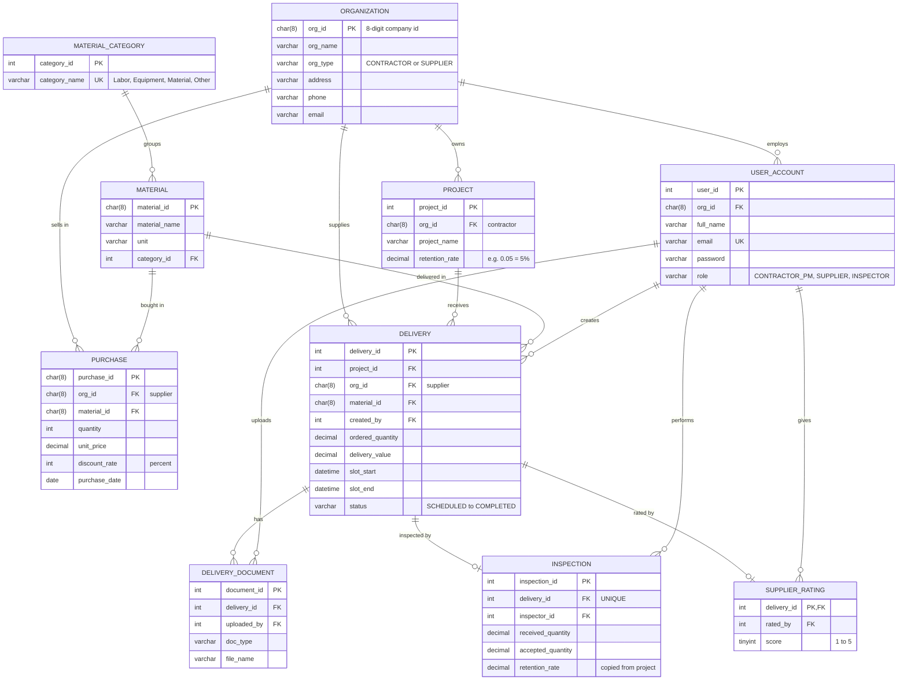

# SiteProof - Data Model (ER Diagram, 3NF)

Data model of SiteProof, based on the user stories (US1-US9) and use cases (UC1-UC10) of the [Business Plan v3](Assignment%20%231/Business_Plan_v3.pdf).
The MVP part is implemented in MySQL 8.4 (scripts `01_schema.sql` to `05_verify.sql`); the tables in Figure 1 are exactly the tables of the database.

## 1. Legend

| Tag | Color in Figure 2 | Meaning |
|---|---|---|
| **MVP** | 🟩 green | Built now. Implemented in MySQL. |
| **PHASE 2** | 🟨 yellow | Planned next: RFQ, LINE notifications, payment requests, Pro tier, featured suppliers, ESG. |
| **PHASE 3** | ⬜ grey, dashed | Future: OCR, budget alerts, GPS, ERP integration, risk analytics. |

Attributes of a later phase inside an MVP table are marked in the comment (for example `quotation_id FK "Phase 2"`). They are not in the MySQL tables yet.

## 2. Figure 1 - MVP data model (implemented in MySQL)

10 tables.



## 3. Figure 2 - Full product (MVP + Phase 2 + Phase 3)

23 entities: the 10 MVP tables plus 8 for Phase 2 and 5 for Phase 3.

```mermaid
erDiagram
    ORGANIZATION["ORGANIZATION - MVP"] {
        char(8) org_id PK "8-digit company id"
        varchar org_name
        varchar org_type "CONTRACTOR or SUPPLIER"
        varchar address
        varchar phone
        varchar email
        char(8) parent_org_id FK "Phase 2: branch"
    }
    USER_ACCOUNT["USER_ACCOUNT - MVP"] {
        int user_id PK
        char(8) org_id FK
        varchar full_name
        varchar email UK
        varchar password
        varchar role "CONTRACTOR_PM, SUPPLIER, INSPECTOR"
        varchar line_user_id "Phase 2: LINE"
    }
    PROJECT["PROJECT - MVP"] {
        int project_id PK
        char(8) org_id FK "contractor"
        varchar project_name
        decimal retention_rate "e.g. 0.05 = 5%"
    }
    MATERIAL_CATEGORY["MATERIAL_CATEGORY - MVP"] {
        int category_id PK
        varchar category_name UK "Labor, Equipment, Material, Other"
    }
    MATERIAL["MATERIAL - MVP"] {
        char(8) material_id PK
        varchar material_name
        varchar unit
        int category_id FK
    }
    PURCHASE["PURCHASE - MVP"] {
        char(8) purchase_id PK
        char(8) org_id FK "supplier"
        char(8) material_id FK
        int quantity
        decimal unit_price
        int discount_rate "percent"
        date purchase_date
    }
    DELIVERY["DELIVERY - MVP"] {
        int delivery_id PK
        int project_id FK
        char(8) org_id FK "supplier"
        char(8) material_id FK
        int created_by FK
        decimal ordered_quantity
        decimal delivery_value
        datetime slot_start
        datetime slot_end
        varchar status "SCHEDULED to COMPLETED"
        int quotation_id FK "Phase 2, nullable"
        int payment_request_id FK "Phase 2, nullable"
    }
    DELIVERY_DOCUMENT["DELIVERY_DOCUMENT - MVP"] {
        int document_id PK
        int delivery_id FK
        int uploaded_by FK
        varchar doc_type
        varchar file_name
    }
    INSPECTION["INSPECTION - MVP"] {
        int inspection_id PK
        int delivery_id FK "UNIQUE"
        int inspector_id FK
        decimal received_quantity
        decimal accepted_quantity
        decimal retention_rate "copied from project"
    }
    SUPPLIER_RATING["SUPPLIER_RATING - MVP"] {
        int delivery_id PK, FK
        int rated_by FK
        tinyint score "1 to 5"
    }
    SUPPLIER_CONNECTION["SUPPLIER_CONNECTION - PHASE 2"] {
        char(8) contractor_org_id PK, FK
        char(8) supplier_org_id PK, FK
        varchar connection_status
    }
    RFQ["RFQ - PHASE 2"] {
        int rfq_id PK
        int project_id FK
        char(8) material_id FK
        int created_by FK
        decimal quantity
        date needed_by
    }
    QUOTATION["QUOTATION - PHASE 2"] {
        int quotation_id PK
        int rfq_id FK
        char(8) org_id FK "supplier"
        decimal unit_price
        int lead_time_days
    }
    NOTIFICATION["NOTIFICATION - PHASE 2"] {
        int notification_id PK
        int user_id FK
        int delivery_id FK "nullable"
        int budget_id FK "Phase 3, nullable"
        varchar notification_type "LINE message"
        datetime sent_at
    }
    PAYMENT_REQUEST["PAYMENT_REQUEST - PHASE 2"] {
        int payment_request_id PK
        char(8) org_id FK "supplier"
        int project_id FK
        date valuation_period
        varchar request_status
    }
    SUBSCRIPTION["SUBSCRIPTION - PHASE 2"] {
        int subscription_id PK
        char(8) org_id FK
        varchar tier "FREE or PRO"
        date start_date
        date end_date
    }
    FEATURED_LISTING["FEATURED_LISTING - PHASE 2"] {
        int listing_id PK
        char(8) org_id FK "supplier"
        int category_id FK
        date start_date
        date end_date
    }
    ESG_RECORD["ESG_RECORD - PHASE 2"] {
        int esg_id PK
        int delivery_id FK "UNIQUE"
        varchar certification_label
        decimal carbon_kg_co2e
    }
    DOCUMENT_EXTRACTION["DOCUMENT_EXTRACTION - PHASE 3"] {
        int extraction_id PK
        int document_id FK
        varchar field_name
        varchar extracted_value
    }
    PROJECT_BUDGET["PROJECT_BUDGET - PHASE 3"] {
        int budget_id PK
        int project_id FK
        int category_id FK
        decimal budget_amount
    }
    DELIVERY_TRACKING_POINT["DELIVERY_TRACKING_POINT - PHASE 3"] {
        int point_id PK
        int delivery_id FK
        decimal latitude
        decimal longitude
        datetime recorded_at
    }
    ERP_SYNC_LOG["ERP_SYNC_LOG - PHASE 3"] {
        int sync_id PK
        char(8) org_id FK
        int delivery_id FK "nullable"
        varchar sync_status
        datetime synced_at
    }
    DELIVERY_RISK_SCORE["DELIVERY_RISK_SCORE - PHASE 3"] {
        int score_id PK
        int delivery_id FK
        decimal risk_score
        datetime computed_at
    }

    ORGANIZATION ||--o{ USER_ACCOUNT : employs
    ORGANIZATION ||--o{ PROJECT : owns
    ORGANIZATION ||--o{ PURCHASE : "sells in"
    MATERIAL ||--o{ PURCHASE : "bought in"
    MATERIAL_CATEGORY ||--o{ MATERIAL : groups
    ORGANIZATION ||--o{ DELIVERY : supplies
    PROJECT ||--o{ DELIVERY : receives
    MATERIAL ||--o{ DELIVERY : "delivered in"
    USER_ACCOUNT ||--o{ DELIVERY : creates
    DELIVERY ||--o{ DELIVERY_DOCUMENT : has
    USER_ACCOUNT ||--o{ DELIVERY_DOCUMENT : uploads
    DELIVERY ||--o| INSPECTION : "inspected by"
    USER_ACCOUNT ||--o{ INSPECTION : performs
    DELIVERY ||--o| SUPPLIER_RATING : "rated by"
    USER_ACCOUNT ||--o{ SUPPLIER_RATING : gives

    ORGANIZATION ||--o{ ORGANIZATION : "has branch"
    ORGANIZATION ||--o{ SUPPLIER_CONNECTION : "lists as contractor"
    ORGANIZATION ||--o{ SUPPLIER_CONNECTION : "listed as supplier"
    PROJECT ||--o{ RFQ : requests
    MATERIAL ||--o{ RFQ : "requested in"
    USER_ACCOUNT ||--o{ RFQ : issues
    RFQ ||--o{ QUOTATION : receives
    ORGANIZATION ||--o{ QUOTATION : submits
    QUOTATION ||--o| DELIVERY : becomes
    ORGANIZATION ||--o{ PAYMENT_REQUEST : submits
    PROJECT ||--o{ PAYMENT_REQUEST : "billed for"
    PAYMENT_REQUEST ||--o{ DELIVERY : includes
    USER_ACCOUNT ||--o{ NOTIFICATION : receives
    DELIVERY |o--o{ NOTIFICATION : triggers
    ORGANIZATION ||--o{ SUBSCRIPTION : holds
    ORGANIZATION ||--o{ FEATURED_LISTING : buys
    MATERIAL_CATEGORY ||--o{ FEATURED_LISTING : "promoted in"
    DELIVERY ||--o| ESG_RECORD : has
    DELIVERY_DOCUMENT ||--o{ DOCUMENT_EXTRACTION : "read by OCR"
    PROJECT ||--o{ PROJECT_BUDGET : budgets
    MATERIAL_CATEGORY ||--o{ PROJECT_BUDGET : "budgeted for"
    PROJECT_BUDGET |o--o{ NOTIFICATION : alerts
    DELIVERY ||--o{ DELIVERY_TRACKING_POINT : "tracked by GPS"
    ORGANIZATION ||--o{ ERP_SYNC_LOG : syncs
    DELIVERY |o--o{ ERP_SYNC_LOG : "synced in"
    DELIVERY ||--o{ DELIVERY_RISK_SCORE : "scored by"

    classDef mvp fill:#bfe8cf,stroke:#1f7a4d,stroke-width:3px,color:#0f2a1c
    classDef p2 fill:#fbe3a0,stroke:#b8860b,stroke-width:2px,color:#2b2100
    classDef p3 fill:#e6e9ee,stroke:#6e7781,stroke-width:2px,stroke-dasharray:5 3,color:#24292f
    class ORGANIZATION,USER_ACCOUNT,PROJECT,MATERIAL_CATEGORY,MATERIAL,PURCHASE,DELIVERY,DELIVERY_DOCUMENT,INSPECTION,SUPPLIER_RATING mvp
    class SUPPLIER_CONNECTION,RFQ,QUOTATION,NOTIFICATION,PAYMENT_REQUEST,SUBSCRIPTION,FEATURED_LISTING,ESG_RECORD p2
    class DOCUMENT_EXTRACTION,PROJECT_BUDGET,DELIVERY_TRACKING_POINT,ERP_SYNC_LOG,DELIVERY_RISK_SCORE p3
```



## 4. MVP tables

| Table | What it stores | Key | Stories / use cases |
|---|---|---|---|
| ORGANIZATION | Contractor and supplier companies | `org_id` (8-digit company id) | US1, US2, US5 |
| USER_ACCOUNT | Users; each one belongs to a company and has one role | `user_id` | US1 / UC1 |
| PROJECT | Projects of a contractor, with the contract retention rate | `project_id` | US2, US3, UC10 |
| MATERIAL_CATEGORY | Categories to search the catalog: Labor, Equipment, Material, Other | `category_id` | US2 |
| MATERIAL | Catalog of materials, labor and equipment | `material_id` (8-digit id) | US2 / UC2 |
| PURCHASE | Past purchases from suppliers (loaded from the data given in class) | `purchase_id` | US3, US7 |
| DELIVERY | The single delivery record: project, supplier, material, quantity, value, time slot, status | `delivery_id` | US2, US3, US5 / UC2, UC3, UC5 |
| DELIVERY_DOCUMENT | Quality documents (PDF/JPG) of a delivery | `document_id` | US6, US8 / UC6 |
| INSPECTION | Received and accepted quantity; one per delivery | `inspection_id` | US8, US9 / UC8-UC10 |
| SUPPLIER_RATING | Mandatory 1-5 rating; one per delivery | `delivery_id` | US4, US7 / UC4, UC7 |

## 5. Business rules (relationships and cardinality)

* A company has zero or many users; a user belongs to exactly one company.
* A contractor has zero or many projects; a project belongs to exactly one contractor.
* A material belongs to exactly one category; a category has zero or many materials.
* A supplier has zero or many purchases; a purchase is from exactly one supplier and for exactly one material.
* A project has zero or many deliveries; a delivery belongs to exactly one project, one supplier and one material, and is created by one user.
* A delivery has zero or many documents.
* A delivery has zero or one inspection (no re-inspection in the MVP) and zero or one rating; the rating is required to complete the delivery.

Other rules (Business Plan v3, section 5.4):

* The accepted quantity cannot be more than the received quantity.
* Accepted value = delivery value x accepted quantity / ordered quantity; retention = accepted value x retention rate. Rejected = 0.
* The retention rate is copied into the inspection when the decision is recorded, so later changes to the project rate do not change old deliveries.
* Status: SCHEDULED, PREPARING, IN_TRANSIT, DELIVERED, INSPECTED, COMPLETED.

## 6. Normalization (3NF)

Examples from the data given in class:

* **1NF (one value per cell):** the companies file has a `comments` column with lists separated by ";". We do not store it in the MVP; if it is needed later it must go to its own table (one row per company and comment).
* **3NF (no column that depends on another non-key column):** the transactions file has `total_price`, which depends on quantity, unit price and discount, not only on the key. We do not store it: the view `purchase_total` calculates it. The notes repeat the discount percentage that is already in `discount_rate`, so they are not stored either.
* Company data (name, address, phone, email) is only in ORGANIZATION, and material data (name, unit, category) only in MATERIAL. PURCHASE and DELIVERY only keep the ids.

Calculated values (not stored):

```sql
CREATE VIEW purchase_total AS
SELECT purchase_id,
       ROUND(quantity * unit_price * (100 - discount_rate) / 100, 2) AS total_price
FROM purchase;
```

Accepted value and retention of a delivery are calculated in the same way from DELIVERY and INSPECTION.

## 7. Keys

* Companies, materials and purchases use the 8-digit ids of the data. They are stored as text (`CHAR(8)`) because they have leading zeros.
* The other tables use an automatic number (`AUTO_INCREMENT`).
* SUPPLIER_RATING uses `delivery_id` as its key, because there is only one rating per delivery. INSPECTION has `delivery_id` as UNIQUE for the same reason.
