  

SiteProof is a web-based platform designed to improve material delivery coordination, supplier management, and inspection processes for general contractors and material suppliers in Taiwan.

This repository contains the project documentation, system design, and future implementation developed for the **Software Engineering in Construction Information Systems** course (CT5805701) at National Taiwan University of Science and Technology (NTUST).

---
## 1. Project Overview

### Problem Statement

Construction material deliveries often involve fragmented communication, inconsistent documentation, and limited visibility into delivery and inspection processes.

These challenges may result in delivery delays, incomplete quality records, and difficulties in evaluating supplier performance.

### Proposed Solution

SiteProof aims to provide a centralized platform that connects general contractors, material suppliers, and site inspectors through a unified material delivery management workflow.

The platform focuses on improving:

- **Delivery Transparency:** Track material delivery status and progress.
- **Document Management:** Centralize quality-related documents.
- **Inspection Management:** Record inspection results and acceptance decisions.
- **Financial Accountability:** Calculate retention on the accepted value at the contract rate (3%–10%).
- **Supplier Evaluation:** Maintain supplier performance ratings and delivery histories.

### Core Workflow — Material Delivery Closed-Loop

SiteProof focuses on a single integrated workflow known as the **Material Delivery Closed-Loop**.

The workflow consists of the following steps:

1. **Delivery Scheduling:** A contractor creates and schedules a material delivery record.
2. **Status Updates:** The supplier updates the delivery status.
3. **Document Submission:** The supplier uploads relevant quality documents.
4. **Inspection and Acceptance:** A site inspector reviews the delivery and records full acceptance, partial acceptance, or rejection.
5. **Retention Calculation:** The system calculates the retention on the accepted value at the contract rate (3%–10%) when the inspector records the acceptance decision.
6. **Supplier Evaluation:** The contractor completes the delivery and gives a mandatory 1–5 supplier rating, whatever the inspection outcome.

All information is maintained within **a single delivery record**, providing a traceable history of the entire delivery process.

---

## 2. Project Scope: MVP vs. Full Product

SiteProof is planned in three phases. **Only Phase 1 is the Minimum Viable Product**: the core, non-negotiable feature set that the team will actually build and deliver as a working product. Phases 2 and 3 are the full product vision: valuable, but not required for the product to launch and function.

Scope tags used in this repository (same colors as the website chart and the data model):

| Tag | Scope | Meaning |
|---|---|---|
| 🟩 **MVP** | Phase 1 | Built first. Required for the Material Delivery Closed-Loop to work. |
| 🟨 **Phase 2** | Expansion | Planned next. Nice to have, not required at launch. |
| ⬜ **Phase 3** | Intelligence | Future vision. |

### 2.1 Use cases

The ten use cases implement the five must-have functions of the Business Plan (Account & Role Management, Delivery Management, Delivery Status Tracking, Receiving & Quality Documentation, Retention & Completion; see the traceability table in its section 5.5).

| ID | Use case | Role | Scope | Status | Page(s) |
|---|---|---|---|---|---|
| UC1 | Sign in with a role-based account (and register a company or a user) | All | 🟩 MVP | ✅ Done | Home / Sign in |
| UC2 | Create a delivery record | Contractor | 🟩 MVP | ✅ Done | Create Delivery Record |
| UC3 | View delivery status, history, retention and supplier ratings | Contractor | 🟩 MVP | ✅ Done | My Deliveries, Delivery Detail, Supplier Ratings |
| UC4 | Complete a delivery and rate the supplier (1–5) | Contractor | 🟩 MVP | ✅ Done | Complete and Rate Supplier |
| UC5 | View assigned deliveries and update their status | Supplier | 🟩 MVP | ✅ Done | Assigned Deliveries and Status Update |
| UC6 | Upload delivery and quality documents | Supplier | 🟩 MVP | ✅ Done | Upload Quality Documents |
| UC7 | View own rating and delivery history | Supplier | 🟩 MVP | ✅ Done | My Rating and History |
| UC8 | Record received quantity and review documents | Inspector | 🟩 MVP | ✅ Done | Inspection Queue, Inspect and Decide |
| UC9 | Accept, partially accept or reject a delivery | Inspector | 🟩 MVP | ✅ Done | Inspect and Decide |
| UC10 | Calculate retention on the accepted value (system, included by UC9) | System | 🟩 MVP | ✅ Done | Inspect and Decide |

Status: ✅ Done = works in the website; 🔶 Partly = some of it works (see section 3.1); ⬜ To do = not started.

### 2.2 Full product scope (not part of the MVP)

| Feature | Scope | Main data entities (see [ERModel.md](ERModel.md)) |
|---|---|---|
| RFQ and quotation comparison | 🟨 Phase 2 (✅ built) | RFQ, RFQ_ITEM, RFQ_SUPPLIER, QUOTATION, QUOTATION_ITEM |
| Notifications in the website (✅ built); LINE messages and 28-day test reminders | 🟨 Phase 2 | NOTIFICATION |
| Digital payment requests | 🟨 Phase 2 | PAYMENT_REQUEST |
| Advanced supplier analytics | 🟨 Phase 2 | Computed from existing MVP data |
| Pro-tier features (multi-project / multi-office, unlimited supplier connections) | 🟨 Phase 2 | SUBSCRIPTION, SUPPLIER_CONNECTION |
| ESG carbon-footprint tracking | 🟨 Phase 2 | ESG_RECORD |
| Featured supplier listings | 🟨 Phase 2 | FEATURED_LISTING, MATERIAL_CATEGORY |
| Mobile optimization | 🟨 Phase 2 | No data model change |
| OCR for quality-inspection PDFs | ⬜ Phase 3 | DOCUMENT_EXTRACTION |
| Budget-overrun alerts | ⬜ Phase 3 | PROJECT_BUDGET |
| GPS / logistics integration | ⬜ Phase 3 | DELIVERY_TRACKING_POINT |
| ERP integration | ⬜ Phase 3 | ERP_SYNC_LOG |
| Predictive delivery-risk analytics | ⬜ Phase 3 | DELIVERY_RISK_SCORE |

The MVP has no push notifications: users see delivery status on the platform. Everything in 2.2 is part of the proposed roadmap and is not included in the initial MVP.

### 2.3 Related documents

* Website structure and page ownership: [Section 6 below](#6-website-structure-and-development-roadmap).
* Normalized data model with MVP vs. full-product entities: [ERModel.md](ERModel.md).

---

## 3. Project Status

SiteProof has moved from planning to implementation. The database and the first version of the website run locally with Docker (see [website/README.md](website/README.md) for the instructions). All ten use cases of the first phase work.

| Component | Status |
|---|---|
| Business Plan | Revised (v3) |
| System Requirements | Defined |
| Website Architecture | Defined |
| Frontend Development | In progress: pages for the five roles (contractor, supplier, inspector, company account, administrator) with Handlebars, HTMX and Bootstrap; every list has search, status filter, sorting and paging, a loading bar and error messages that stay in the corner of the window; the new-delivery form has a search box for the supplier and a material picker with category buttons and a search box; accessible and usable with the keyboard only (skip link, real buttons, labelled form fields, focus moves to the right place after each update); checked with axe-core: 0 violations |
| Backend Development | In progress: Express routes with sign-in, registration, role check (checked in the database at every request) and company-level data isolation |
| Database Design | MVP tables implemented in MySQL, loaded with the given data and with sample data ([ERModel.md](ERModel.md)) |
| System Testing | Automated tests with `node:test` (`npm test`, see [website/README.md](website/README.md)): unit tests of the login limit, file upload, role check and lists, and a system test of the whole closed loop on a separate test database; plus manual tests with the sample data |

### 3.1 Use case progress

| Use case | Status | What works now |
|---|---|---|
| UC1 Sign in and registration | Done | Sign in and sign out; each role starts on its own page; other roles cannot open the page. Registration of a company (with proof documents; the website administrator approves it) and of users (they choose an approved company, with a search box, and can sign in only after the company account approves them); the company account approves, rejects and switches off the users of its company; the company account of a contractor creates, edits and deletes the projects; a contractor appoints third-party inspection companies; the administrator account sees all companies and users ([website/README.md](website/README.md), section 2.1) |
| UC2 Create a delivery record | Done | Contractor creates, edits and deletes delivery records (edit and delete only while SCHEDULED) |
| UC3 View delivery status, history, retention and ratings | Done | List with status for the contractor, and a detail page for each delivery: progress with the time of each step, order, on time or late, documents, inspection, retention, rating and the full history (who did what and when) in one place |
| UC4 Complete a delivery and rate the supplier | Done | Rating 1 to 5, can be changed or deleted |
| UC5 Update the delivery status | Done | Supplier sees the assigned deliveries and moves each one step by step: PREPARING, IN_TRANSIT, DELIVERED; a SCHEDULED delivery can be declined with a reason, and the contractor changes or deletes it |
| UC6 Quality documents | Done | Supplier uploads the file (PDF, JPG or PNG, at most 5 MB; the real type is checked) at any time, and changes (also the file) or deletes it until the inspection; the contractor and the inspectors open the files from their pages |
| UC7 Supplier rating and history | Done | Supplier sees the average rating, how the scores are distributed and the history of its deliveries with the inspection result |
| UC8 Record received quantity and review documents | Done | The inspector sees the quality documents of each delivery (or a warning when there are none) in the list and in the inspection form, then records the received quantity |
| UC9 Accept, partially accept or reject | Done | Decision from the received and accepted quantity |
| UC10 Retention | Done | Accepted value and retention are calculated by the system (the retention rate is copied from the project at the inspection) |

Beyond the ten use cases, the supplier keeps a **product catalog** (My products): the materials that its company can provide, with the price range, minimum order and lead time ([website/README.md](website/README.md), section 2.2). The contractor searches all the listed products (Find products), compares the suppliers of a material by price, lead time and rating, and starts a delivery from a product with one click (section 2.3). This is the first step of the RFQ and quotation workflow of phase 2.

**Requests for quotation (RFQ, phase 2):** the contractor writes an RFQ for a project (materials and quantities, wanted delivery slot, last day for the quotations) and invites suppliers; the suppliers that offer the most materials in their catalog are suggested first. A draft can be changed and deleted; after **Send** it cannot be changed or deleted any more, only cancelled ([website/README.md](website/README.md), section 2.4). The invited suppliers answer with a **quotation** (a unit price for each material, lead time, note) and can change or withdraw it until the last day (section 2.5). The contractor **compares the quotations side by side** and **accepts** one: the deliveries are created automatically for that supplier and continue in the closed loop above (section 2.6). The whole story of the assignment works: supplier products → RFQ → quotations → decision → delivery → inspection → rating.

**Notifications:** every user has a bell in the menu with the number of new notifications: a new delivery, a status change, a delivery that arrived and must be inspected, an inspection result, a rating, an RFQ, a quotation, a decision or a new registration ([website/README.md](website/README.md), section 2.7). **Messages:** the contractor, the supplier and the inspectors talk about a delivery in its conversation, and the contractor asks each invited supplier questions about an RFQ in a private conversation (section 2.8). **Company overview:** the company account sees all the orders of its company with totals (deliveries, values, retention, ratings, inspections), read only (section 2.11).

The whole closed loop works from the first step to the last: the contractor creates a delivery, the supplier moves it to DELIVERED, the inspector inspects it, the contractor completes it with a rating, and the supplier sees the rating.

**Security and everyday use:** the login cookie is never signed with the public example secret, wrong passwords are limited, the database uses Taiwan time, the login lasts while the user works, forgotten passwords are reset with a temporary password, inspections and ratings are saved in one transaction, and the supplier pages work on a phone ([website/README.md](website/README.md), section 2.12).

**Automated tests:** `npm test` in the website folder runs 102 tests (`node:test`), from the registration to the RFQ and the whole closed loop ([website/README.md](website/README.md), "Automated tests").

**Next:** the rest of the second phase (see section 2).

---
## 4. Project Documents

**Current Version:** v3 (2026-10-06; section 5.4 clarified 2026-10-26)
Revised for consistency; supersedes the versions originally submitted.

| Document | Format | Link |
|---|---|---|
| Business Plan | PDF | [View PDF](Assignment%20%231/Business_Plan_v3.pdf) |
| Business Plan | Word | [View DOCX](Assignment%20%231/Business_Plan_v3.docx) |
| Business Plan Presentation | PowerPoint | [View PPTX](Assignment%20%231/SiteProof_Business_Plan_Presentation_v3.pptx) |
| Database and ETL report | PDF | [View PDF](database/SiteProof_Database_ETL.pdf) |

---
## 5. Team Members and Responsibilities

| Member | Student ID | Primary Role |
|---|---|---|
| 鄭博浩 (Po-Hao Cheng) | M11505503 | Software Engineer / System Architect |
| A. Samuel Arzamendia | M11405807 | Business Analyst / Quality Control |

---
## 6. Website Structure and Development Roadmap

The following diagram illustrates the proposed website structure, page ownership, and development priorities.

Each node represents a planned page, functional interface, or future feature group.

**Development priorities are indicated by node color.**

```mermaid
graph TD
    HOME["Home / Sign in<br/>UC1<br/>Owner: Po-Hao"]:::p1

    HOME --> CON["Contractor Area"]:::p1
    HOME --> SUP["Supplier Area"]:::p1
    HOME --> INS["Inspector Area"]:::p1

    CON --> C1["My Deliveries<br/>List and Status / UC3<br/>Owner: Po-Hao"]:::p1
    CON --> C2["Create Delivery Record<br/>UC2<br/>Owner: Po-Hao"]:::p1
    CON --> C3["Delivery Detail<br/>Status, Documents, Acceptance, Retention / UC3<br/>Owner: Po-Hao"]:::p1
    CON --> C4["Complete and Rate Supplier<br/>UC4<br/>Owner: Samuel"]:::p1
    CON --> C5["Supplier Ratings<br/>UC3<br/>Owner: Samuel"]:::p1

    SUP --> S1["Assigned Deliveries and Status Update<br/>UC5<br/>Owner: Po-Hao"]:::p1
    SUP --> S2["Upload Quality Documents<br/>UC6<br/>Owner: Po-Hao"]:::p1
    SUP --> S3["My Rating and History<br/>UC7<br/>Owner: Po-Hao"]:::p1

    INS --> I1["Inspection Queue<br/>Deliveries to Inspect / UC8<br/>Owner: Samuel"]:::p1
    INS --> I2["Inspect and Decide<br/>Quantity, Documents, Acceptance, Retention<br/>UC8, UC9, UC10<br/>Owner: Samuel"]:::p1
    HOME --> REG["Register a Company or a User<br/>UC1<br/>Owner: Po-Hao"]:::p1
    HOME --> COM["Company Account Area"]:::p1
    HOME --> ADM["Administrator Area"]:::p1
    COM --> M1["Approve Users, Projects, Inspection Companies<br/>UC1<br/>Owner: Po-Hao"]:::p1
    COM --> M2["Company Overview<br/>All Orders and Totals<br/>Owner: Po-Hao"]:::p1
    HOME --> ALL["Every User: Notifications, Messages, My Account<br/>Owner: Po-Hao"]:::p1
    ADM --> A1["Approve Companies, See All Users<br/>UC1<br/>Owner: Po-Hao"]:::p1
    CON --> C6["Find Products<br/>Product Catalog<br/>Owner: Po-Hao"]:::p1
    SUP --> S4["My Products<br/>Product Catalog<br/>Owner: Po-Hao"]:::p1
    CON --> C7["Requests for Quotation<br/>Create, Send, Compare, Accept<br/>Owner: Po-Hao"]:::p1
    SUP --> S5["Quotations<br/>Answer the RFQs<br/>Owner: Po-Hao"]:::p1

    HOME -.-> F2["Phase 2 — Planned Features<br/>LINE Notifications, Payment Requests,<br/>Analytics, Pro Tier, Featured Suppliers, Mobile<br/>Owner: To Be Assigned"]:::p2

    HOME -.-> F3["Phase 3 — Advanced Features<br/>OCR, Budget Alerts, ERP and GPS Integration,<br/>Delivery-Risk Analytics<br/>Owner: To Be Assigned"]:::p3

    classDef p1 fill:#1f7a4d,stroke:#145a38,color:#ffffff
    classDef p2 fill:#f2c14e,stroke:#b8860b,color:#1a1a1a
    classDef p3 fill:#c9d1d9,stroke:#8b949e,color:#1a1a1a
```

### Priority legend

| Color | Priority | Scope |
|---|---|---|
| 🟩 Green | 1 — build first | Phase 1 MVP (the five must-have functions) |
| 🟨 Yellow | 2 — build next | Phase 2 expansion |
| ⬜ Grey | 3 — build later | Phase 3 intelligence |

### Page-Level Responsibilities

| Page | Use case | Priority | Owner | Status |
|---|---|---|---|---|
| Home / Sign in | UC1 | 1 | Po-Hao | ✅ Done |
| My Deliveries | UC3 | 1 | Po-Hao | ✅ Done |
| Create Delivery Record | UC2 | 1 | Po-Hao | ✅ Done |
| Delivery Detail | UC3 | 1 | Po-Hao | ✅ Done |
| Complete and Rate Supplier | UC4 | 1 | Samuel | ✅ Done |
| Supplier Ratings | UC3 | 1 | Samuel | 🔶 Partly |
| Assigned Deliveries and Status Update | UC5 | 1 | Po-Hao | ✅ Done |
| Upload Quality Documents | UC6 | 1 | Po-Hao | ✅ Done |
| My Rating and History | UC7 | 1 | Po-Hao | ✅ Done |
| Inspection Queue | UC8 | 1 | Samuel | ✅ Done |
| Inspect and Decide | UC8, UC9, UC10 | 1 | Samuel | ✅ Done |
| Register a Company or a User | UC1 | 1 | Po-Hao | ✅ Done |
| Company Account (users, projects, inspection companies) | UC1 | 1 | Po-Hao | ✅ Done |
| Administrator (companies and users) | UC1 | 1 | Po-Hao | ✅ Done |
| Administrator: all products of all suppliers (read only) | Product catalog | 2 | Po-Hao | ✅ Done |
| Find Products (contractor) | Product catalog | 1 | Po-Hao | ✅ Done |
| My Products (supplier) | Product catalog | 1 | Po-Hao | ✅ Done |
| Requests for Quotation (contractor: create, send, compare, accept) | RFQ (phase 2) | 2 | Po-Hao | ✅ Done |
| Quotations (supplier: send, change, withdraw) | RFQ (phase 2) | 2 | Po-Hao | ✅ Done |
| Company Overview (all orders of the company, totals) | UC3 | 2 | Po-Hao | ✅ Done |
| Notifications (every user) | Phase 2 | 2 | Po-Hao | ✅ Done |
| Messages (contractor, supplier, inspector) | Phase 2 | 2 | Po-Hao | ✅ Done |
| My Account (change the password) | UC1 | 2 | Po-Hao | ✅ Done |
| Phase 2 and Phase 3 pages | — | 2 / 3 | To be assigned | ⬜ To do |

Status: ✅ Done, 🔶 Partly, ⬜ To do (details in section 3.1). "Supplier Ratings" is partly done because the rating of each delivery is shown on the Complete and Rate page and on the Delivery Detail page, but there is no separate page with the average rating of each supplier.

**Note:** Page ownership indicates the primary person responsible for implementation. Responsibilities may be adjusted during development.

## 7. Technology Stack

Frontend and backend follow the course requirements (3-tier web application) and the technology of the laboratories. The database is MySQL 8.4 (run in Docker).

| Component | Technology |
|---|---|
| Frontend | HTML, Bootstrap 5, Handlebars templates, HTMX 4 |
| Backend | Node.js 22 + Express 5 (mysql2, cookie-parser, bcryptjs, multer) |
| Database | MySQL 8.4 (Docker) |
| Deployment | Docker on a local computer (cloud deployment to be decided) |
| Testing Framework | Node.js built-in test runner (`node:test`, `node:assert`) |

---

## 8. Development Notes

- The Phase 1 MVP focuses on completing the Material Delivery Closed-Loop.
- Each delivery record serves as the central reference for delivery status, documentation, inspection results, retention calculations, and supplier evaluations.
- System design and implementation decisions will be documented as development progresses.
- Additional features will be considered according to development priorities and available project resources.

---

## 9. Academic Information

**Project:** SiteProof — Smart Delivery & Supplier Management Platform

**Course:** Software Engineering in Construction Information Systems

**Course Code:** CT5805701

**Institution:** National Taiwan University of Science and Technology (NTUST)

**Project Type:** Academic Course Project
