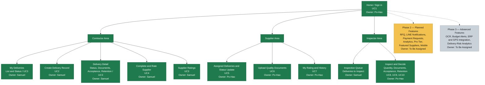

  

SiteProof is a web-based platform designed to improve material delivery coordination, supplier management, and inspection processes for general contractors and material suppliers in Taiwan.

This repository contains the project documentation, system design, and future implementation developed for the **Software Engineering in Construction Information Systems** course (CT5805701) at National Taiwan University of Science and Technology (NTUST).

---
## 1. Project Overview

### Problem Statement

Construction material deliveries often involve fragmented communication, inconsistent documentation, and limited visibility into delivery and inspection processes.

These challenges may result in delivery delays, incomplete quality records, and difficulties in evaluating supplier performance.

### Proposed Solution

SiteProof aims to provide a centralized platform that connects general contractors, material suppliers, and site inspectors through a unified material delivery management workflow.

The platform focuses on improving:

- **Delivery Transparency:** Track material delivery status and progress.
- **Document Management:** Centralize quality-related documents.
- **Inspection Management:** Record inspection results and acceptance decisions.
- **Financial Accountability:** Calculate retention on the accepted value at the contract rate (3%–10%).
- **Supplier Evaluation:** Maintain supplier performance ratings and delivery histories.

### Core Workflow — Material Delivery Closed-Loop

SiteProof focuses on a single integrated workflow known as the **Material Delivery Closed-Loop**.

The workflow consists of the following steps:

1. **Delivery Scheduling:** A contractor creates and schedules a material delivery record.
2. **Status Updates:** The supplier updates the delivery status.
3. **Document Submission:** The supplier uploads relevant quality documents.
4. **Inspection and Acceptance:** A site inspector reviews the delivery and records full acceptance, partial acceptance, or rejection.
5. **Retention Calculation:** The system calculates the retention on the accepted value at the contract rate (3%–10%) when the inspector records the acceptance decision.
6. **Supplier Evaluation:** The contractor completes the delivery and gives a mandatory 1–5 supplier rating, whatever the inspection outcome.

All information is maintained within **a single delivery record**, providing a traceable history of the entire delivery process.

---

## 2. Project Scope: MVP vs. Full Product

SiteProof is planned in three phases. **Only Phase 1 is the Minimum Viable Product**: the core, non-negotiable feature set that the team will actually build and deliver as a working product. Phases 2 and 3 are the full product vision: valuable, but not required for the product to launch and function.

> 📝 **UPDATED — MVP definition:** The “five must-have functions” are the five end-to-end workflow stages (create delivery, update status, submit documents, inspect/decide, and complete/rate). UC1 (sign-in) is a shared prerequisite. UC1–UC10 below are all MVP use cases that implement or support those five stages; they are not ten separate must-have functions.

Scope tags used in this repository (same colors as the website chart and the data model):

| Tag | Scope | Meaning |
|---|---|---|
| 🟩 **MVP** | Phase 1 | Built first. Required for the Material Delivery Closed-Loop to work. |
| 🟨 **Phase 2** | Expansion | Planned next. Nice to have, not required at launch. |
| ⬜ **Phase 3** | Intelligence | Future vision. |

### 2.1 Use cases

| ID | Use case | Role | Scope | Page(s) |
|---|---|---|---|---|
| UC1 | Sign in with a role-based account | All | 🟩 MVP | Home / Sign in |
| UC2 | Create a delivery record | Contractor | 🟩 MVP | Create Delivery Record |
| UC3 | View delivery status, history, retention and supplier ratings | Contractor | 🟩 MVP | My Deliveries, Delivery Detail, Supplier Ratings |
| UC4 | Complete a delivery and rate the supplier (1–5) | Contractor | 🟩 MVP | Complete and Rate Supplier |
| UC5 | View assigned deliveries and update their status | Supplier | 🟩 MVP | Assigned Deliveries and Status Update |
| UC6 | Upload delivery and quality documents | Supplier | 🟩 MVP | Upload Quality Documents |
| UC7 | View own rating and delivery history | Supplier | 🟩 MVP | My Rating and History |
| UC8 | Record received quantity and review documents | Inspector | 🟩 MVP | Inspection Queue, Inspect and Decide |
| UC9 | Accept, partially accept or reject a delivery | Inspector | 🟩 MVP | Inspect and Decide |
| UC10 | Calculate retention on the accepted value (system, included by UC9) | System | 🟩 MVP | Inspect and Decide |

### 2.2 Full product scope (not part of the MVP)

| Feature | Scope | Main data entities (see [ERModel.md](ERModel.md)) |
|---|---|---|
| RFQ and quotation comparison | 🟨 Phase 2 | RFQ, QUOTATION |
| LINE notifications and 28-day test reminders | 🟨 Phase 2 | NOTIFICATION |
| Digital payment requests | 🟨 Phase 2 | PAYMENT_REQUEST |
| Advanced supplier analytics | 🟨 Phase 2 | Computed from existing MVP data |
| Pro-tier features (multi-project / multi-office, unlimited supplier connections) | 🟨 Phase 2 | SUBSCRIPTION, SUPPLIER_CONNECTION |
| ESG carbon-footprint tracking | 🟨 Phase 2 | ESG_RECORD |
| Featured supplier listings | 🟨 Phase 2 | FEATURED_LISTING, MATERIAL_CATEGORY |
| Mobile optimization | 🟨 Phase 2 | No data model change |
| OCR for quality-inspection PDFs | ⬜ Phase 3 | DOCUMENT_EXTRACTION |
| Budget-overrun alerts | ⬜ Phase 3 | PROJECT_BUDGET |
| GPS / logistics integration | ⬜ Phase 3 | DELIVERY_TRACKING_POINT |
| ERP integration | ⬜ Phase 3 | ERP_SYNC_LOG |
| Predictive delivery-risk analytics | ⬜ Phase 3 | DELIVERY_RISK_SCORE |

The MVP has no push notifications: users see delivery status on the platform. Everything in 2.2 is part of the proposed roadmap and is not included in the initial MVP.

> 📝 **UPDATED — scope clarification:** The five workflow stages are a summary of the MVP, not a replacement for the use-case list. All ten use cases in section 2.1 remain in Phase 1, including role-based sign-in.

### 2.3 Related documents

* Website structure and page ownership: [Section 6 below](#6-website-structure-and-development-roadmap).
* Normalized data model with MVP vs. full-product entities: [ERModel.md](ERModel.md).

---

## 3. Project Status

SiteProof is currently in the planning and system design stage.

Implementation progress will be updated as the project develops.

| Component | Status |
|---|---|
| Business Plan | Revised (v3) |
| System Requirements | Defined |
| Website Architecture | Defined |
| Frontend Development | Not started |
| Backend Development | Not started |
| Database Design | Not started |
| System Testing | Not started |

---
## 4. Project Documents

**Current Version:** v3 (2026-10-06)
Revised for consistency; supersedes the versions originally submitted.

| Document | Format | Link |
|---|---|---|
| Business Plan | PDF | [View PDF](Assignment%20%231/Business_Plan_v3.pdf) |
| Business Plan | Word | [View DOCX](Assignment%20%231/Business_Plan_v3.docx) |
| Business Plan Presentation | PowerPoint | [View PPTX](Assignment%20%231/SiteProof_Business_Plan_Presentation_v3.pptx) |

---
## 5. Team Members and Responsibilities

| Member | Student ID | Primary Role |
|---|---|---|
| 鄭博浩 (Po-Hao Cheng) | M11505503 | Software Engineer / System Architect |
| A. Samuel Arzamendia | M11405807 | Business Analyst / Quality Control |

---
## 6. Website Structure and Development Roadmap

The following diagram illustrates the proposed website structure, page ownership, and development priorities.

Each node represents a planned page, functional interface, or future feature group.

**Development priorities are indicated by node color.**

### Priority legend

| Color | Priority | Scope |
|---|---|---|
| 🟩 Green | 1 — build first | Phase 1 MVP (the five must-have functions) |
| 🟨 Yellow | 2 — build next | Phase 2 expansion |
| ⬜ Grey | 3 — build later | Phase 3 intelligence |

### Page-Level Responsibilities

| Page | Use case | Priority | Owner |
|---|---|---|---|
| Home / Sign in | UC1 | 1 | Po-Hao |
| My Deliveries | UC3 | 1 | Samuel |
| Create Delivery Record | UC2 | 1 | Samuel |
| Delivery Detail | UC3 | 1 | Samuel |
| Complete and Rate Supplier | UC4 | 1 | Samuel |
| Supplier Ratings | UC3 | 1 | Samuel |
| Assigned Deliveries and Status Update | UC5 | 1 | Po-Hao |
| Upload Quality Documents | UC6 | 1 | Po-Hao |
| My Rating and History | UC7 | 1 | Po-Hao |
| Inspection Queue | UC8 | 1 | Samuel |
| Inspect and Decide | UC8, UC9, UC10 | 1 | Po-Hao |
| Phase 2 and Phase 3 pages | — | 2 / 3 | To be assigned |

**Note:** Page ownership indicates the primary person responsible for implementation. Responsibilities may be adjusted during development.

## 7. Technology Stack

Frontend and backend follow the course requirements (3-tier web application). Database, deployment and testing tools will be determined during system design.

| Component | Technology |
|---|---|
| Frontend | HTML, CSS, JavaScript |
| Backend | Node.js + Express.js |
| Database | TBD |
| Deployment | TBD |
| Testing Framework | TBD |

---

## 8. Development Notes

- The Phase 1 MVP focuses on completing the Material Delivery Closed-Loop.
- Each delivery record serves as the central reference for delivery status, documentation, inspection results, retention calculations, and supplier evaluations.
- System design and implementation decisions will be documented as development progresses.
- Additional features will be considered according to development priorities and available project resources.

---

## 9. Academic Information

**Project:** SiteProof — Smart Delivery & Supplier Management Platform

**Course:** Software Engineering in Construction Information Systems

**Course Code:** CT5805701

**Institution:** National Taiwan University of Science and Technology (NTUST)

**Project Type:** Academic Course Project
